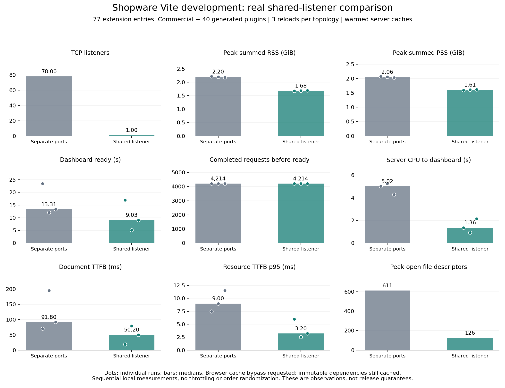

# Acceptance checks and measured shared-listener results

> Historical research record from 2026-10-27/28.
> See the archive [README](README.md) and [support matrix](SUPPORT_MATRIX.md) for the current scope.

This record supersedes the outstanding-checks section in [the initial review](2026-10-28-review-and-port-pr.md).
Research, benchmark programs, raw results, and this document stay outside both Shopware PRs.

## Verdict

The default Vite 8 development path is ready for broader draft review after the new regression fixes.
The port change is worthwhile even if page-load speed is excluded from its claim: 78 TCP listeners become one while extension compiler configuration stays isolated.
The local measurements also show lower server memory and CPU cost.
The samples are too few and variable for a general speed or capacity guarantee.
Experimental bundled development renders the actual Administration and applies edits, but does not yet preserve component state for these template edits.
It is not equivalent to the verified default HMR path.

## Final validation

- HMR branch: 893 related tests against current trunk.
- Port branch: 55 related tests against current trunk, including certificate verification and actual Vite servers.
- Combined branch: 948 tests in 24 suites.
- Combined production Administration and extension build: passed.
- Final authenticated browser after trunk/cache repair: simultaneous Twig and native template edits preserved the counter at 2.
  Both fixture sources were restored byte for byte afterward.
  Browser evidence: final HMR screenshot (retained in the local evidence backup).
- Direct lint of the changed tooling and runtime files: passed.
- Full composer eslint:admin, including TypeScript, SCSS, and formatting: passed with existing warnings.
- Both merge orders produce tree `f5448c9347e5aaab18e708041897197e9d1e13d9`.
- HMR PR head: `979a72aa178`.
- Port PR head: `07e1110`.
- Trunk used for final validation: `c2ee631c74d`.

## Acceptance matrix

| Case | Result | Evidence and boundary |
| --- | --- | --- |
| Same alias and virtual-module identifiers in different extensions | Pass | Actual Vite servers, separate alias, config, resolve, load, transform, and middleware hooks. |
| Conflicting versions of a dependency | Pass | Versions 1 and 2 remain isolated in fetched module graphs. |
| Symlinks and linked peer dependencies | Pass | Real directory symlinks, a workspace package, and pnpm-shaped dependency storage; this does not certify every pnpm monorepo. |
| Extension-only HMR | Pass | Real WebSocket connections; an edit reaches its extension and leaves the control extension unchanged. |
| Invalid source then repair | Pass | HTTP 500 for broken source, other extensions and host remain healthy, repaired source returns JavaScript again. |
| Failed extension startup | Pass | Failed extension returns 503; partially configured child resources close; restart after repair recovers. |
| Extension config edit | Pass | Config reload applies without breaking the other extension. |
| Repeated parent restarts | Pass | Three restarts retain one listener and the expected upgrade-handler count; shutdown empties all captured watchers. |
| HTTPS and WSS | Pass | Actual HTTP and WebSocket traffic with a generated certificate trusted explicitly by the test client; certificate verification stays enabled. |
| TLS reverse proxy | Pass | Different public port, explicit trusted CA, per-extension WebSocket isolation. |
| Bundled entries and HMR transport | Pass | Actual built JavaScript and update payloads; HTTP 200 loading HTML is not accepted as readiness. |
| Real bundled Administration | Pass with limitation | Dashboard renders and Twig/native edits apply; those template edits reload the page and reset local state. |
| Nested Twig blocks, parent blocks, override ordering | Pass | Repeated edits preserve later overrides and do not accumulate duplicate content. |
| Component.extend descendants | Fixed and tested | Already-resolved child and grandchild templates now refresh after an inherited override changes. |
| Prebuilt but unresolved Vue component | Pass | Its first resolution uses the edited template. |
| Malformed Twig then repair | Pass | Repair succeeds and requests a rerender after the invalid edit is rejected. |
| Removed or deleted lazy registration | Fixed and tested | Stale HMR associations are removed; renamed registrations do not duplicate handlers. |
| Native setup SFC template and style edits | Pass in default mode | Template edit preserved the real dashboard counter at 1; script fingerprint excludes templates and styles. |
| Native setup SFC script edits | Safe reload in default mode | Valid script edits reload the page and rerun registration; invalid script reports an error before reload. |
| Commercial Twig override | Pass in default mode | Real ContentGenerator CMS text override tested through the shared listener in the previous acceptance run. |
| Meteor app and Admin entry in one bundle | Pass | Separate prefixes; real app render and isolated update tested in the previous acceptance run. |
| Vite 6 and custom port | Pass | Legacy process topology and port 5190 tested previously; updated unit coverage retains the legacy proxy path. |
| Windows execution | Not run | Fixtures use junctions on Windows; execution evidence is Linux in Podman on macOS. |
| Arbitrary non-root reverse-proxy mount | Not covered | TLS acceptance uses the existing root Admin URL contract. |
| Lighthouse performance score | Not available | Current connector's Lighthouse audit excludes performance; the short auto trace did not capture a valid LCP comparison and is not reported as a performance score. |

## Fixes found by these checks

1. A user configureServer hook could fail after Vite installed listeners.
   Capture the partial child before user hooks and close it on failure.
2. Child transform errors could fall through to the parent Administration HTML and return HTTP 200.
   Preserve the failure status and terminate the extension request at its own boundary.
3. Vite constructs a replacement server before closing the previous generation.
   Scope child groups and cleanup to their parent environments instead of sharing one mutable map across generations.
4. Twig updates refreshed the named component but left resolved Component.extend descendants stale.
   Rebuild and rerender only the affected resolved template descendants.
5. Removing all lazy override registrations bypassed association cleanup through an early return.
   Clear importer associations before that return and on deletion.
6. Native setup script edits could leave registered setup overrides stale.
   Detect loaded script changes and request a full reload after successful validation.

## Measurement method

Use the same dedicated Shopware database, Commercial checkout, and 40 generated extension fixtures.
Commercial feature bundles plus the generated plugins produce 77 Administration extension entries.
The temporary Meteor app is excluded from the comparison: the old topology cannot reliably distinguish it from its same-name Admin entry.
The old topology and shared-listener topology contain the same HMR implementation.
The shared topology is the actual middleware implementation in the PR, not the earlier Environment API prototype.
These measurements precede the final trunk synchronization; the synchronization is covered by subsequent functional tests, not a repeated performance claim.

Run two warm-up browser navigations and three recorded reloads for each topology.
Keep server dependency caches warm and request browser cache bypass on every reload.
Resource Timing still reports cached immutable dependencies, so these results are not cold-browser or cold-server numbers.
The runs are sequential, without randomized order or CPU/network throttling.
Other browser tabs and the host remain present.

Dashboard readiness is the first DOM insertion of the rendered native counter button in the authenticated dashboard.
The normal document load event occurs much earlier and is reported separately in the raw data.
Request count means completed Resource Timing entries started before readiness, plus the document, collected 250 ms after readiness.
It is not a count of all requests ever initiated by the page.

Sample the launcher's Node process group every 250 ms through Linux procfs.
Include the launcher and all Node compiler processes; exclude the sampler, browser, PHP, and database.
Summed RSS can count shared library pages more than once; PSS is also recorded.
CPU seconds come from process user/system ticks and the measured CLK_TCK value of 100.
CPU windows run from navigation start to dashboard readiness and have approximately one sample interval of boundary uncertainty.
Inotify figures count kernel watch registrations, not watched source files.

## Results

| Metric | Separate listeners | Shared listener |
| --- | ---: | ---: |
| TCP listeners | 78 | 1 |
| Node processes including launcher | 3 | 2 |
| Highest summed RSS during recorded navigations | 2.213 GiB | 1.695 GiB |
| Highest summed PSS during recorded navigations | 2.076 GiB | 1.620 GiB |
| Peak open file descriptors during sampling | 611 | 126 |
| Inotify watch registrations | 19,195 | 19,203 |
| Dashboard readiness, three runs | 23.49 / 12.10 / 13.31 s | 16.94 / 5.05 / 9.03 s |
| Median dashboard readiness | 13.31 s | 9.03 s |
| Completed requests before readiness, median | 4,214 | 4,214 |
| Document TTFB, median | 91.8 ms | 50.2 ms |
| Resource TTFB p95, median across runs | 9.0 ms | 3.2 ms |
| Node CPU to dashboard readiness, median | 5.02 CPU seconds | 1.36 CPU seconds |

The deterministic result is listener consolidation.
Memory is about 0.52 GiB lower at the observed peaks in this lane.
The load-time ranges overlap, so a percentage speedup would overstate the evidence.
The browser still fetches approximately the same module graph.
The watcher count is essentially unchanged, as expected with isolated compiler instances.

Raw evidence: [baseline browser](browser-baseline.json), [shared browser](browser-shared.json), [baseline process samples](baseline-live-samples.json), [shared process samples](shared-live-samples.json), and [derived values](live-comparison-summary.json).
The [analysis program](analyze-live-comparison.py) regenerates the graph and derived values.

## Decision log

- Retain per-extension compiler instances to preserve existing extension config and dependency boundaries.
- Share HTTP and WebSocket transport and remove the extra extension launcher process in Vite 8 mode.
- Keep the existing Vite 8 feature flag as the activation boundary.
- Use a full page reload for native script changes until setup registration and replay have a safe replacement contract.
- Treat bundled state-preserving template HMR as separate work: the installed Vite bundled pipeline returns before calling hotUpdate hooks.
- Keep the HTTPS certificate test client explicit about its trusted CA; do not bypass browser security warnings.
- Use generated, disposable integration fixtures in regression tests; keep benchmark fixtures and research outside the PRs.
- Merge current trunk into both branches without rewriting their published history.

## Remaining work before a broad release claim

- A bundled-mode adapter if bundled development must preserve state on Twig and native template edits.
- Investigate the bundled-mode FSWatcher MaxListeners warning; it is observed under the 77-entry workload and is not silently suppressed.
- Native Windows execution and additional real extension authors' configurations.
- A longer randomized benchmark with cold and warm cache cohorts before publishing speed or capacity promises.
- Review the latest CI results and obtain maintainer review before merging the drafts.

## Change impact

- Blast radius: Administration development tooling with ADMIN_VITE_8 enabled and development-only component template invalidation.
- Who pays: enabled development sessions; the HMR bridge exits for production and disabled-feature sessions.
- Easier or more complex: one externally managed port, while extension configuration remains independent.
- Verdict: ship as independently reviewable drafts, with the bundled-mode limitation stated explicitly.

## CI dependency audit observation

The latest port PR audit failed on deepmerge (GHSA-gcqx-w48m-w2h4) and qs (GHSA-6pq8-jhm2-2vcw).
An npm audit against the untouched package.json and lockfile from trunk c2ee631c74d reports the same two advisories.
Neither advisory comes from the added ws test dependency.
No audit exception or unrelated dependency upgrade is added to either feature PR.
The drafts still need their final CI verdict before merge.

## Final lane repair after trunk synchronization

The PHP API initially returned HTTP 500 after updating trunk.
A direct kernel request with exception catching disabled reproduced a stale compiled-container constructor call: EntityWriteGateway received five arguments while the updated source requires six.
A proper cache clear rebuilt the container and restored the locales API to HTTP 200.

The Commercial checkout's shopware.yaml also declares SSO.major as a boolean, while current trunk requires a canonical parent-version string.
The dedicated container copy now uses major: v6.8.0.0.
The primary Commercial source is unchanged.
The Commercial Mutagen session retains its original exclusions and additionally excludes /src/Resources/config/packages/shopware.yaml to keep this local compatibility adaptation stable across synchronization and future cache clears.
Its replacement session ID is sync_h6jAUeoNeJHo5wYZUkJlK4UW4pUq6qT9daNRYvz31uN.
This adaptation and the cache repair are absent from both PRs.
The Administration Vite 8 flag remained enabled after the cache clear.

## Handoff state

The local combined branch is codex/admin-vite-integration at fe96a2be8b3.
The authenticated dashboard remains running at http://localhost:5181/#/sw/dashboard/index.
The restored Twig and native fixture templates both retain counter state 2 after their final hot updates.
The same-bundle Meteor fixture is restored in the local test lane.
Both published PRs remain drafts and GitHub reports them mergeable.
The PR diffs contain source, dependency declarations, and regression tests only.
No benchmark scripts, research documents, generated extension corpus, or Commercial compatibility changes were pushed.

## CodeQL follow-up

CodeQL identified two test-harness HTTP request paths with unconstrained destinations.
Fixture requests now validate loopback URLs and use a literal loopback hostname in the request options.
The TLS test proxy also uses a literal loopback upstream hostname; incoming URLs populate only its request path.
A negative assertion verifies that a non-loopback URL is rejected.
The 14 shared-listener tests, direct lint, and TypeScript check passed after the change.
The fix is pushed as a follow-up commit on the port PR; the later CodeQL check is neutral with zero annotations and a missing nightly baseline-configuration warning, so this is not a complete clean security comparison.

## Fresh dependency-scan regression

A final clean restart exposed the native virtual-SFC filename being read directly from disk by Vite's dependency scanner.
The Admin still rendered through on-demand loading, but the optimizer skipped dependency pre-bundling.
The setup plugin now lets scan requests resolve the authored Vue file instead of substituting its virtual compilation ID.
A regression test failed before this change and passes afterward.
After moving one fixture's dependency cache aside, the real shared server rebuilt its Vue cache with no dependency-scan failures.
The combined 948 tests passed after the scanner and HTTP-test-boundary fixes.

## Real App lifecycle follow-up

The later [real App and SDK lifecycle acceptance](app-lifecycle/README.md) adds the missing App coverage to the plugin and Commercial checks above.
It records 17 browser checkpoints and 47 passing existing SDK/iframe tests.
A real installed and signed App and a plugin-bundled Meteor SDK app both keep their registrations singular during safe view HMR.
Registration-source or iframe restarts retain the existing full Administration reload, after which all registration counts return to one.
A deliberate unsafe registration replay reproduces duplicate sections and modules without an iframe load, while same-ID tabs upsert.
The unsafe probe has been removed, and no tracked Shopware changes or PR commits were needed for this acceptance run.

The earlier handoff statement that the Meteor fixture is restored is superseded for the local test lane: it now contains the SDK lifecycle probe alongside the real App.
The additional App devserver and loopback callback helper are research processes and were not included in the earlier performance measurements.
The independent App server is outside the port PR's shared-listener scope.

## Script-HMR research and revised merge-readiness assessment

The later [script-HMR feasibility assessment](full-script-hmr/README.md) supersedes any inference that broad draft-review readiness means the HMR PR is already merge-ready.
Four runtime experiments validate Vue's targeted remount behavior and demonstrate why native override append/removal is not a safe replacement lifecycle.
A new live browser probe found that editing a TypeScript helper imported by a native override leaves the old computed result visible until a manual reload.
The existing HMR PR needs a regression and safe reload fallback for dependency-driven script updates before merge.
The port PR remains independently reviewable with its existing audit and CodeQL-baseline qualifications.
The temporary browser probe was restored byte for byte, its helper was removed, and both SDK fixtures have singular registrations again.
All new research and experiments remain outside the PRs.

## Template HMR dependency safety fix

The imported-helper blocker documented in the script-HMR assessment is addressed by [the dependency-safety follow-up](template-hmr-ready/README.md).
Commit f616fb0 follows runtime dependency importers to loaded native setup SFCs, compiles the change, and requests a safe page reload.
The final implementation passes 942 related tests in 25 suites, TypeScript, the full Admin lint wrapper, and live helper/template recovery checks.
Native and Twig template changes still preserve the dashboard counter at 2.
The two feature branches still combine in either order to tree 998e104fa3195a126d31f8d5743411a2477e662c.
Fresh exact-head CI is tracked separately from those local results.
