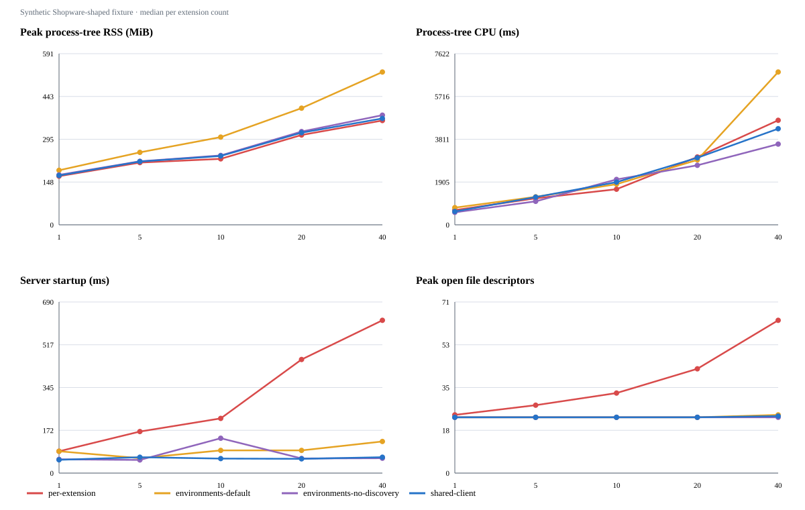

# Administration Vite development-server prototype

> Historical research record from 2026-10-27/28.
> See the archive [README](../README.md) and [support matrix](../SUPPORT_MATRIX.md) for the current scope.

This prototype compares Vite server topologies against a Shopware-shaped extension fixture and a real isolated Shopware Vite 8 development lane.

The standalone matrix does not change the Administration watcher or boot Shopware.

The real Shopware baseline is run separately in the dedicated `vite-poc` `sw-dev` lane.

## Fixture model

The fixture follows the Administration and `custom/plugins/<name>/src/Resources/app/administration/src` layout.

It writes a `var/plugins.json` manifest and discovers plugin entries and Meteor app HTML using the predicates and path rules in `loadExtensions()`.

It writes a `sw-plugin-dev.json` manifest with the `js`, `hmrSrc`, and `html` entry URLs used by the Administration.

The base plugin profile contains 36 TypeScript modules, 14 Twig templates, 6 Sass files, 4 JSON files, and 2 Vue components.

The profile contains 64 transformable source files plus a Vite config file and totals about 216 KB per plugin.

Those generated source sizes are calibrated against two extension source trees in this checkout.

`SwagAgenticCommerce` has 90 source files and 276,689 bytes, while `SwagExtensionStore` has 123 source files and 458,804 bytes.

The `--source-multiplier=2` profile creates 126 transformable source files and about 432 KB per plugin, close to the larger checked-in source tree.

An optional `--app-every=4` setting inserts one Meteor app for every four discovered extensions.

The app fixture uses the app `meteor-app/index.html` discovery rule and a smaller HTML/TypeScript/JSON source profile.

## Compared server topologies

`per-extension` creates one Administration server and one server per extension, matching the current server/listener fan-out.

The prototype keeps those server instances in one measured Node process, while Shopware currently runs the Administration server in a separate process.

`environments-default` creates one Vite server with one named client environment per extension and gives each environment its own extension entry for dependency scanning.

`environments-no-discovery` uses the same environments with `optimizeDeps.noDiscovery` and an empty include list.

`shared-client` uses one Vite client environment and routes namespaced extension modules through its one module graph.

All modes use the installed Vite 8.3.3 package and the Vue compiler configuration used by the Administration extension watcher.

The fixture includes a Twig transform, per-extension config transforms, extension-local aliases, Sass, JSON, Vue SFCs, and glob imports.

The fixture does not load the full Shopware Vite plugin stack or arbitrary customer configuration.

## Measurements

The benchmark records server startup, module transform time, total run time, process-tree RSS, process-tree CPU time, open file descriptors, inotify watches, process count, and thread count.

It samples `/proc` every 100 ms while Vite servers start and fixture modules transform.

Each base matrix point runs twice and the CSV reports the median.

The worker aborts when its process-tree RSS exceeds 4 GiB or it runs longer than 180 seconds.

The results are process-level Vite measurements and exclude a browser, customer extensions, and the booted Shopware application.

The Administration root does not statically import extension entries; the extension manifests and named-environment entries model the runtime discovery path.

## Run

Run these commands from the repository root inside the linked Shopware development container.

```bash
podman compose exec -T web node dev-tools/admin-vite-environment-poc/run-poc.mjs 2 shared-client
podman compose exec -T web node dev-tools/admin-vite-environment-poc/benchmark.mjs --counts=1,5,10,20,40 --modes=per-extension,environments-default,environments-no-discovery,shared-client --runs=2
podman compose exec -T web node dev-tools/admin-vite-environment-poc/benchmark.mjs --counts=40 --modes=per-extension,environments-default,environments-no-discovery,shared-client --source-multiplier=2
podman compose exec -T web node dev-tools/admin-vite-environment-poc/benchmark.mjs --counts=4,20,40 --modes=per-extension,environments-no-discovery,shared-client --app-every=4
```

The first command runs the browser-oriented HMR fixture.

The benchmark command writes `raw.json`, `summary.csv`, `graphs.svg`, and a result README under `results/latest` by default.

Use `--output=dev-tools/admin-vite-environment-poc/results/<name>` to preserve a named result set.

Set `POC_MAX_RSS_MIB` or `POC_WORKER_TIMEOUT_MS` to adjust the worker safety limits.

Use `--summary-only=true --output=<result-directory>` to regenerate the summary and graphs from saved `raw.json` without rerunning the matrix.

## Real Shopware lane

The dedicated lane starts a real Shopware runtime and enables `ADMIN_VITE_8` only in that environment.

The PHP app is exposed at `http://localhost:8110/` and the browser's Administration development entry point is `http://localhost:5181/` while the local container environment is running.

The PHP `/admin` route can return a loading shell without script tags when no Administration entrypoint artifact has been built and installed, so an HTTP 200 from that route is not browser-render verification.

The 40 generated plugins are discovered by Shopware, activated through the plugin lifecycle, included in `bundle:dump`, and served by the production Vite 8 extension watcher configuration.

The first four generated plugins use real `Shopware.Component.override()` calls against the dashboard, manufacturer detail, product detail, and order detail components.

Each of those overrides imports a Twig block template and adds a small visible note to an existing Administration screen.

The remaining plugins keep the larger source-graph profile used by the 40-extension resource benchmark.

The fixture contains 36 TypeScript modules, 14 Twig templates, 6 Sass files, 4 JSON files, and 2 Vue components per plugin.

The generated files are intentionally kept out of version control under ignored `custom/plugins` paths.

Generate them from the repository root with `node dev-tools/admin-vite-environment-poc/generate-shopware-fixture.mjs --count=40`.

After refreshing and activating the fixtures, enable Vite 8 and rebuild the JS feature manifest with `bin/console feature:enable ADMIN_VITE_8` followed by `bin/console feature:dump`.

Run `bin/console bundle:dump` after activation so the Administration watcher sees the complete extension list.

Start the measured watcher and verification with `node dev-tools/admin-vite-environment-poc/run-shopware-vite8-benchmark.mjs`.

The runner requests every extension module graph, tests Twig HMR isolation, records 20 seconds of resource samples, writes six SVG graphs and stops the watcher process tree on completion.

The runner targets the container-local backend URL by default so browser API requests reach Shopware through the Vite proxy.

Set `VITE_POC_BACKEND_URL` to override that target when the backend listens on another container-local address.

Run `node dev-tools/admin-vite-environment-poc/verify-shopware-fixture.mjs --all-graphs --hmr` to repeat graph and Twig HMR checks against an already-running watcher.

The generator's `--clean=true` option removes only plugin directories carrying its fixture marker.

## Test Twig HMR today

With the dedicated watcher running, open `http://localhost:5181/#/sw/dashboard/index` to see the dashboard card added by `VitePocPlugin01`.

The fixture template is `custom/plugins/VitePocPlugin01/src/Resources/app/administration/src/views/view-01.twig`.

The fixture's eager Twig glob excludes this file because the dashboard component imports it directly and a second unaccepted glob importer would make Vite fall back to a full page reload.

Edit the text `Dashboard Twig extension: edit this text to test HMR.` and save the file.

The mounted dashboard now updates the rendered text in place when the file is saved, without a manual page refresh.

The implementation is gated by `ADMIN_VITE_8` and development mode and uses Vue's internal development HMR runtime.

The Vite 8 development plugin injects the HMR accept callback for supported static Twig imports.

The behavioral fixtures use lazy `Shopware.Component.override(name, () => import('./component'))` registration and a separate component module that imports Twig and returns `Component.wrapComponentConfig({ template })`.

This matches the structure used by `SwagCommercial`'s ContentGenerator `sw-cms-el-text` override.

The isolated POC container does not mount the full Commercial checkout, so the fixture instructions below validate the same registration and module shape with generated plugins.

A separate Shopware lane now executes the mounted Commercial package and verifies live Twig updates in its CMS text element; see the [Commercial test report](results/commercial-test-2026-10-27.md).

Three other small real overrides appear on the manufacturer, product, and order detail screens.

The manufacturer fixture can be checked at `http://localhost:5181/#/sw/manufacturer/detail/01a17d1047d57359a47bb5c6b40f0a7e`.

To check state preservation, change the manufacturer Name field without saving, then edit `custom/plugins/VitePocPlugin02/src/Resources/app/administration/src/views/view-01.twig` and save it.

The updated Twig note should appear while the unsaved Name value remains in the form.

Do not press Save during this check; restore the Twig file after testing.

For a deterministic check, run `node dev-tools/admin-vite-environment-poc/verify-shopware-fixture.mjs --hmr` inside the web container.

The verifier changes the dashboard Twig file, confirms plugin 1 receives a file-change and HMR update while plugin 2 receives none, then restores the original file.

Set `VITE_POC_DEBUG_HMR=1` before the command to print raw WebSocket messages while diagnosing an update.

The authenticated browser check confirms the changed text appears in the mounted dashboard and then returns to the original text when the verifier restores the file.

## Check native SFC HMR

The dashboard also renders `custom/plugins/VitePocPlugin01/src/Resources/app/administration/src/sw-dashboard-index.override.vue` through a native `<sw-block>` override.

The button's counter is local component state and can be clicked before editing the SFC.

Click the button first so its counter is `1`, then run `podman compose exec -T web node dev-tools/admin-vite-environment-poc/verify-shopware-fixture.mjs --native-hmr --hold-visible=20000`.

The verifier changes the SFC template, checks that plugin 1 receives the virtual module update while plugin 2 receives none, holds the changed file for browser inspection, and restores the original file.

On 27 October 2026, the authenticated dashboard displayed the changed text while retaining counter state `1`, then returned to the original text when the verifier restored the source.

The Vite 8 development build applies template-only updates to Shopware setup-SFC modules through a development-only HMR callback that asks Vue's HMR runtime to rerender the updated render function after Shopware's setup-SFC callback.

Twig and native Vue SFC updates use separate compiler/runtime paths.

This proves the dashboard setup-SFC template case only; script, style, ordinary non-setup SFC, delete/rename, error-recovery, and broader mixed Twig/SFC compatibility cases remain to be tested before claiming full HMR support.

To probe script changes, run the same verifier with `--native-script-hmr` instead of `--native-hmr`.

The script update reaches the browser's HMR client, but the displayed setup value stays unchanged; this is a known gap, not a successful browser HMR check.

The manufacturer detail check also confirms a Twig update and source restoration preserve an unsaved Name field value.

See the [Shopware Vite 8 baseline](results/shopware-vite8-40-extensions-2026-10-27/README.md) and [decision log](../06-vite-shared-server-poc-decision-log.md) for results, decisions, and limitations.

The current baseline still lacks browser request counts, TTFB, navigation timings, Lighthouse results, browser CPU/heap, and edit-to-visible-update latency.

The saved [Lighthouse config](lighthouserc.shopware-vite8.cjs) could not launch the container's incompatible bundled Chrome, so no browser performance result is claimed.

The shared-server feature is not justified for adoption until these metrics are collected against both the current per-extension topology and a working shared-server prototype.

## Current results

The base 40-plugin matrix and its plots are saved under [results/2026-10-27](results/2026-10-27/README.md).

The 40-plugin, doubled-source run is saved under [results/large-extension-profile-2026-10-27](results/large-extension-profile-2026-10-27/README.md).

The 40-extension app mix with 10 synthetic apps is saved under [results/apps-mix-2026-10-27](results/apps-mix-2026-10-27/README.md).



At 40 plugins in the base profile, the current per-extension topology creates 41 Vite servers and listeners and samples at about 360 MiB RSS.

The shared client graph creates one server and listener and samples at about 367 MiB RSS, so this run does not show a RAM reduction.

The shared client graph starts in about 64 ms compared with about 616 ms for the per-extension topology, while total startup plus transforms is about 3.1 seconds compared with about 3.3 seconds.

Named environments with default dependency discovery use about 527 MiB RSS and take about 4.2 seconds total in this run.

Named environments with explicit no-discovery use about 378 MiB RSS and take about 2.5 seconds total, but still retain 42 independent environments.

The larger doubled-source run reports about 416 MiB for per-extension servers, 692 MiB for named environments with default discovery, 479 MiB for named environments without discovery, and 501 MiB for the shared client graph.

These results suggest the shared graph removes server and listener fan-out, while memory savings depend on extension graph size and are not yet strong enough to claim as a customer outcome.

## Limits and next work

The generated module mix resembles local Shopware source counts and byte sizes but does not execute the actual plugin source trees.

The per-extension baseline shares one Node process for all Vite instances and therefore does not include the extra process overhead of the real Administration server.

The fixture does not yet model the full asset, override-component, virtual-module, and Vue-global plugin interactions from `build/plugins.vite.ts`.

It also does not prove compatibility for duplicate aliases, plugin names, config hooks, optimized dependencies, symlinks, or unusual customer Vite configs.

The earlier lightweight prototype's Chrome check remains a two-plugin HMR check and does not measure browser heap, request count, Twig HMR, or edit-to-screen latency at 40 plugins.

The next step is to repeat the real Shopware run with representative customer extensions, followed by browser measurements for request count, browser heap, and edit-to-screen latency.

The first real Shopware baseline is now available under [results/shopware-vite8-40-extensions-2026-10-27](results/shopware-vite8-40-extensions-2026-10-27/README.md).

Its measurements supersede synthetic RSS values for absolute Shopware resource estimates, while the standalone benchmark remains useful for controlled topology comparisons.

Review [the decision log](../06-vite-shared-server-poc-decision-log.md) before interpreting the baseline or selecting the next architecture experiment.
