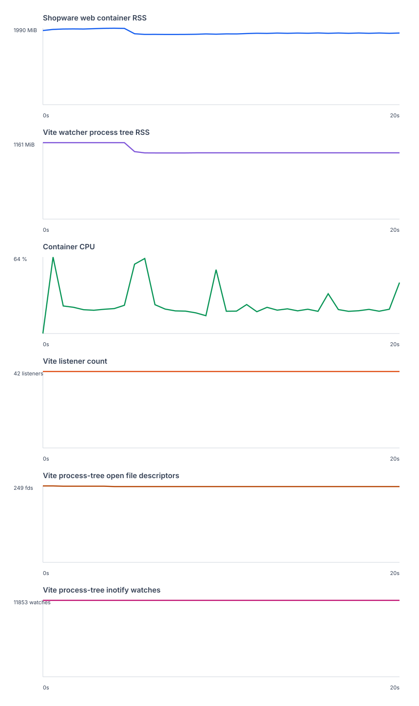

# Shopware Vite 8 watcher run

> Historical research record from 2026-10-27/28.
> See the archive [README](../../../README.md) and [support matrix](../../../SUPPORT_MATRIX.md) for the current scope.

This run used 41 active Shopware Administration entries with Vite 8 enabled through ADMIN_VITE_8.

- Main Vite server readiness: 885 ms.
- Extension Vite servers ready: 2070 ms.
- Extension Vite server instances: 41.
- Container RSS median / peak: 1858.9 / 1989.6 MiB.
- Vite process-tree RSS median / peak: 1006.7 / 1161.0 MiB.
- Container CPU median / peak: 20.4 / 64.3%.
- Process / fd / thread median: 4 / 247 / 72.
- Inotify watches in the Vite process tree: 11853.
- Listening Vite ports: 42.
- Peak container RSS while transforming all extension graphs: 2113.4 MiB.

The run fetched all 41 extension graphs and verified a Twig HMR event isolated to plugin 1.

RSS and CPU include the Shopware web container services for container metrics and the npm dev process tree for Vite metrics.

At the time of this resource run, all 40 generated plugin source trees were synthetic Shopware plugins with the real directory shape, plugin lifecycle, extension dump, and Administration Vite plugin stack.

Four generated plugins were later upgraded to real component Twig overrides for browser behavior checks.

These saved resource measurements predate those behavioral fixture changes and have not been rerun against the updated source.

The Vite watcher used `http://127.0.0.1:8000` as its container-local backend proxy target.

The browser UI and its memory use are outside this resource measurement.

The separate [browser validation](browser-validation.md) authenticated against the local Shopware backend and rendered the Administration dashboard.

The browser check did not record browser memory or edit-to-visible-screen latency.

The raw samples, CSV series, and logs are saved alongside this note.
