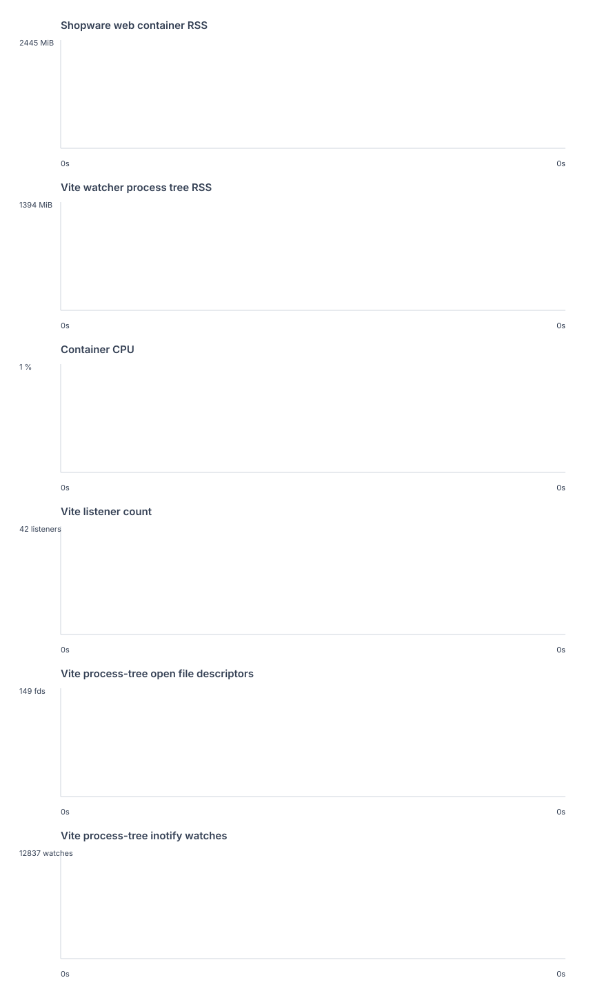

# Shopware Vite 8 watcher run

> Historical research record from 2026-10-27/28.
> See the archive [README](../../../README.md) and [support matrix](../../../SUPPORT_MATRIX.md) for the current scope.

This run used 41 active Shopware Administration entries with Vite 8 enabled through ADMIN_VITE_8.

- Main Vite server readiness: 1007 ms.
- Extension Vite servers ready: 2804 ms.
- Extension Vite server instances: 41.
- Container RSS median / peak: 2445.2 / 2445.2 MiB.
- Vite process-tree RSS median / peak: 1393.5 / 1393.5 MiB.
- Container CPU median / peak: 0.0 / 0.0%.
- Process / fd / thread median: 4 / 149 / 88.
- Inotify watches in the Vite process tree: 12837.
- Listening Vite ports: 42.
- Peak container RSS while transforming all extension graphs: 2645.2 MiB.

The run fetched all 41 extension graphs and verified a Twig HMR event isolated to plugin 1.

RSS and CPU include the Shopware web container services for container metrics and the npm dev process tree for Vite metrics.

The Vite watcher used http://127.0.0.1:8000 as its container-local backend proxy target.

The generated plugin source trees are synthetic Shopware plugins with the real directory shape, plugin lifecycle, extension dump, and Administration Vite plugin stack.

The browser UI and its memory use are outside this measurement.

The raw samples, CSV series, and logs are saved alongside this note.
